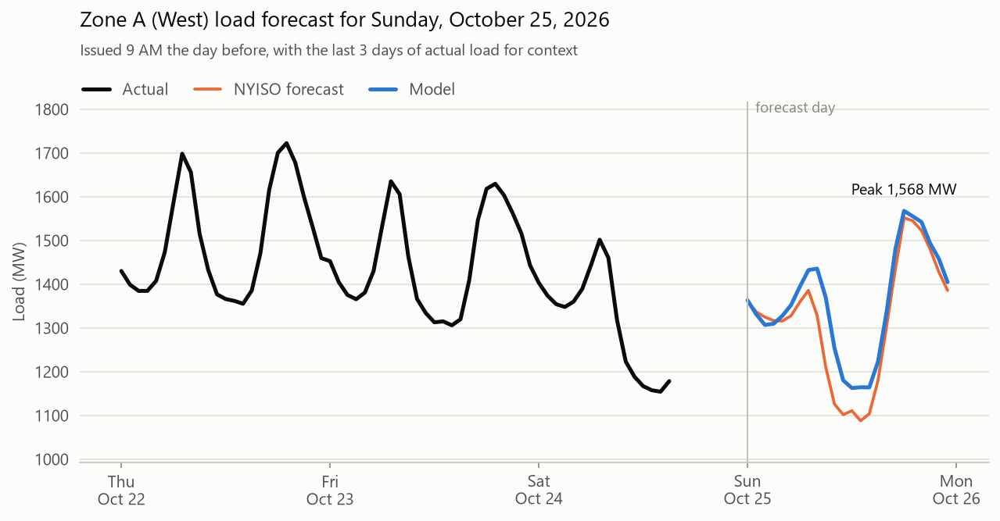
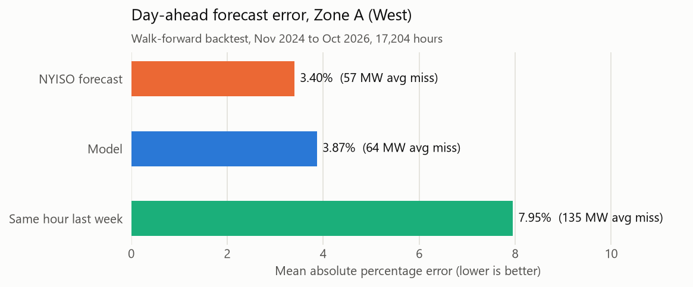
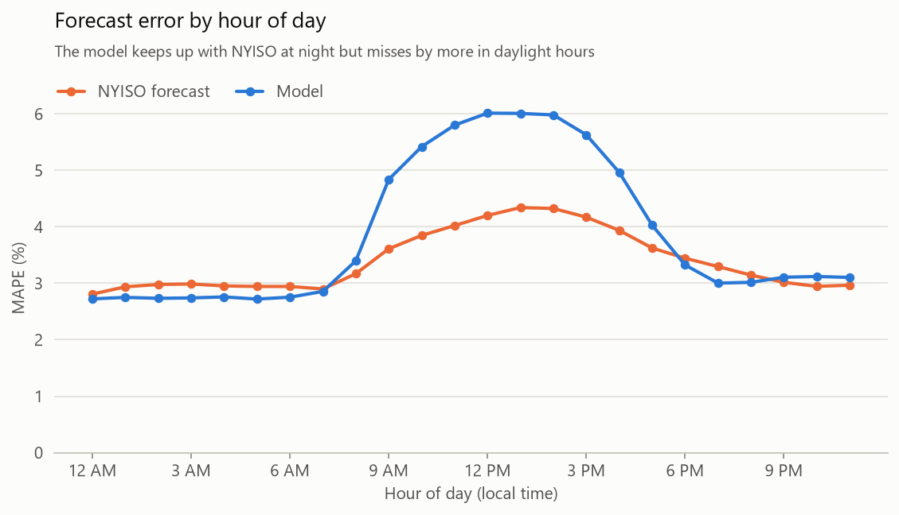
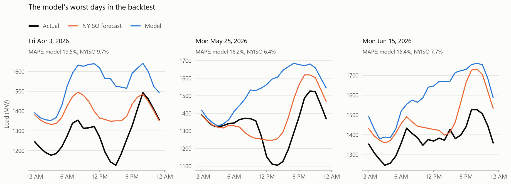
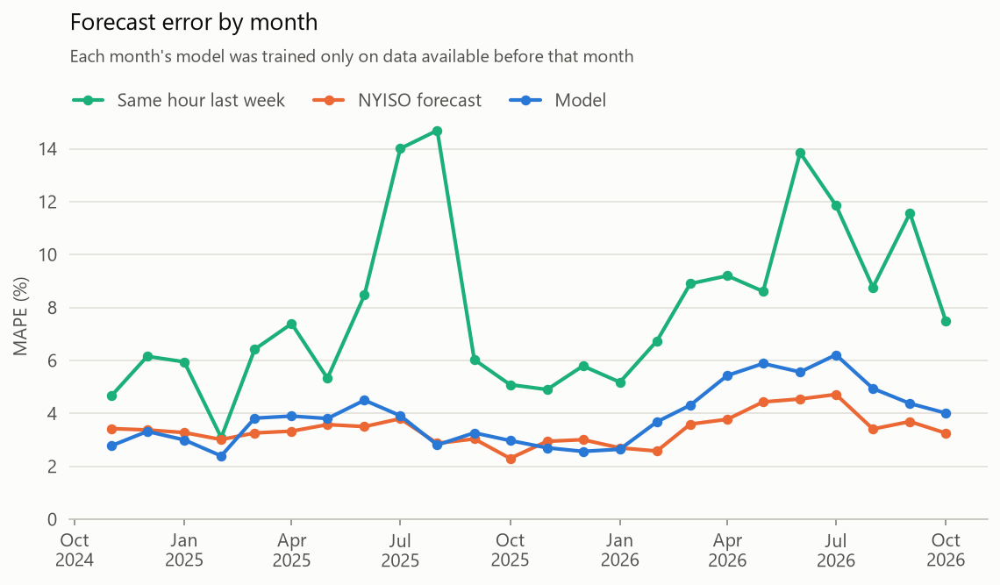
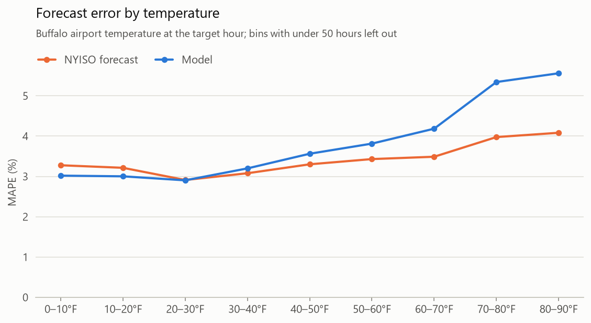
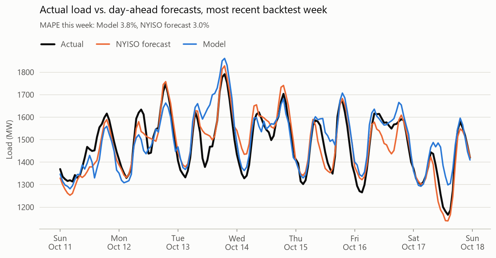

# Western New York Day-Ahead Load Forecast

Forecasting hourly electricity demand for **NYISO Zone A (West)**, the Buffalo region,
one day ahead, and comparing the model honestly against simple baselines and NYISO's
own published forecast. The end goal is a self-updating dashboard hosted on a home server
that publishes a forecast every day and tracks its accuracy over time.

## The problem

Grid operators have to match electricity supply to demand every hour. Day-ahead load
forecasts drive which power plants are scheduled, so better forecasts mean lower costs and
fewer reliability problems, especially during heat waves and cold snaps.

## Setup

**Forecast time.** The forecast for every hour of day D is issued at 9:00 AM local time on
day D-1 (`ISSUE_HOUR` in `wnyload/config.py`). Every load-based feature uses only hours that
had finished by then, so the backtest never sees information the model wouldn't have had.

**Data (all public, free)**
| Source | What | Used for |
|---|---|---|
| NYISO `palIntegrated` | Hourly actual load by zone | Target and lag features |
| NYISO `isolf` | NYISO's own load forecast | Benchmark to beat |
| Open-Meteo archive / forecast | Hourly Buffalo (KBUF) weather | Weather features |

**Features:** hour, day of week, season, holidays; load from the same hour 1 day (when
known), 2 days and 7 days earlier, last observed load, mean load two days earlier;
temperature, humidity, dew point, cloud cover, wind, solar radiation, heating and cooling
degree hours, 24-hour mean temperature.

**Validation:** walk-forward. Each month, the model is retrained on everything observed
before that month's first forecast, then forecasts the whole month. Results are reported
over the last 24 months on hours where every model has a forecast.

**Baselines**
- *Seasonal naive:* the same hour one week earlier
- *NYISO:* NYISO's day-ahead forecast for Zone A

## Running it

```bash
pip install -r requirements.txt
python -m wnyload.download        # NYISO load + forecasts + weather, cached in data/raw
python -m wnyload.run_backtest    # features, walk-forward backtest, report and charts in reports/
python -m wnyload.forecast        # forecast tomorrow, saved to reports/forecasts/
```

`python -m wnyload.forecast --day 2026-10-22` forecasts a past day exactly as it would have
been forecast at the time (trained only on data before 9 AM the day before), so it can be
checked against the actual load. `python -m wnyload.charts` redraws the backtest charts
without re-running the backtest.



## Results

Walk-forward backtest, November 2024 to October 2026, 17,204 hours where every model has a
forecast:

| Forecast | MAPE | MAE | RMSE |
|---|---|---|---|
| NYISO day-ahead forecast | **3.40%** | 57 MW | 74 MW |
| This model (LightGBM) | 3.87% | 64 MW | 87 MW |
| Same hour last week | 7.95% | 135 MW | 185 MW |



The model cuts the naive baseline's error in half but does not yet beat NYISO. Overnight and
in the evening it is as good as NYISO or slightly better; the whole gap comes from daylight
hours.



**Why: rooftop solar.** Solar panels behind customers' meters lower the load the grid sees
on sunny days, and there are more of them every year. The model learns from past years, so
it expects more midday load than there now is. Its midday (10 AM to 3 PM) bias grows over
time and with sunshine, while NYISO's stays near zero:

| Midday hours | Model bias | NYISO bias |
|---|---|---|
| Second half of 2024 | −27 MW | −50 MW |
| First half of 2026 | +78 MW | −4 MW |
| Second half of 2026 | +130 MW | +4 MW |
| Cloudy (under 100 W/m² of sunlight) | −25 MW | −59 MW |
| Full sun (over 700 W/m²) | +121 MW | +16 MW |

The model's worst days are all sunny spring and summer days, when actual load dropped
sharply around midday and the model expected a normal day:



The same pattern shows up month by month (the gap widens from spring 2026) and by
temperature (the model falls behind on warm, usually sunny, days):





Full numbers: `reports/backtest_metrics.json`, `reports/backtest_monthly_mape.csv` and the
ten worst days in `reports/worst_days.csv`.

## Known limitations

- **Weather forecast vs. actual weather.** The backtest uses historical (reanalysis)
  weather, but the live system must use weather *forecasts*, which have their own errors.
  Backtest accuracy is therefore somewhat optimistic; the live dashboard measures the
  real number.
- **Issue time vs. NYISO.** NYISO updates its forecast several times a day. The comparison
  uses the forecast file published on day D-1, which may have been issued at a different
  hour than this model's 9 AM issue time.
- **One weather point.** Zone A is large; Buffalo airport weather is a simplification.

## Roadmap

1. ~~First backtest and error analysis~~ (done; see Results)
2. Feature and model improvements: account for growing rooftop solar first (a time trend,
   weighting recent data more, or solar capacity data from NYSERDA's IEDR), then
   hyperparameter tuning and more weather points
3. Daily job: fetch data, forecast tomorrow, score yesterday (`wnyload.forecast` is the
   forecasting half)
4. Dashboard (Streamlit or FastAPI) in Docker on a home server, published through Cloudflare Tunnel
